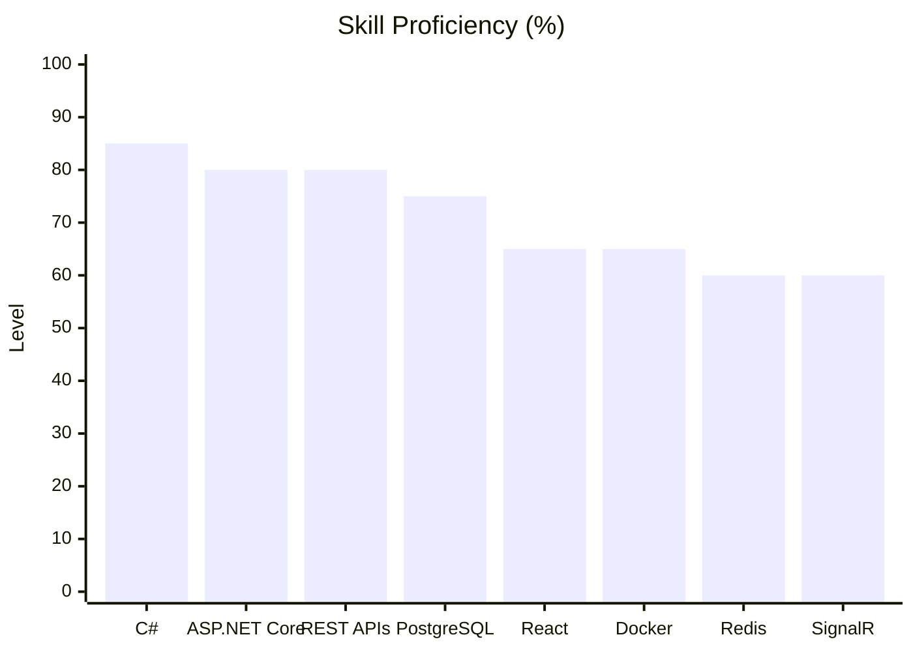

<!-- HEADER -->
<div align="center">


<a href="https://github.com/Blazeee-007">
  
</a>

<br/>

[](https://www.linkedin.com/in/sai-sasank-vanapalli/)
[](https://leetcode.com/u/sidzzz_eren/)
[](mailto:saisasankvanapalli@gmail.com)
<!-- Resume badge: uncomment and replace YOUR_RESUME_LINK
[](YOUR_RESUME_LINK)
-->

</div>

<br/>

## `> whoami`

```csharp
var sai = new Developer
{
    Name      = "Sai Sasank Vanapalli",
    Role      = "Backend .NET Developer",
    Education = "B.Tech Computer Science Engineering (final year)",
    Location  = "India",
    CoreStack = new[] { "C#", ".NET", "ASP.NET Core", "SQL" },
    Loves     = new[] { "REST APIs", "Databases", "Scalable Systems" },
    Practices = "DSA on LeetCode",
    AskMeAbout = new[] { "C#", ".NET", "APIs", "SQL" }
};
```

<br/>

## `> stack`

<table>
  <tr>
    <td width="170"><b>🧠 Languages</b></td>
    <td>
      
      
      
      
      
      
    </td>
  </tr>
  <tr>
    <td><b>⚙️ Backend</b></td>
    <td>
      
      
      
      
      
      
      
    </td>
  </tr>
  <tr>
    <td><b>🗄️ Databases</b></td>
    <td>
      
      
      
      
    </td>
  </tr>
  <tr>
    <td><b>🎨 Frontend</b></td>
    <td>
      
      
      
    </td>
  </tr>
  <tr>
    <td><b>🧰 Tools</b></td>
    <td>
      
      
      
      
      
      
    </td>
  </tr>
</table>

<br/>

<details>
<summary><b>📈 Skill proficiency (self-assessed)</b></summary>



</details>

<br/>

## `> now`

<table>
  <tr>
    <td width="33%" valign="top">

**🌱 Learning**<br/>
System design<br/>
Advanced C# & ASP.NET Core<br/>
Authentication & authorization

</td>
    <td width="33%" valign="top">

**🛠️ Practicing**<br/>
DSA & problem-solving<br/>
Database design & optimization<br/>
Clean, maintainable code

</td>
    <td width="33%" valign="top">

**🎯 Aiming for**<br/>
A backend software engineer role<br/>
Scalable, well-designed systems<br/>
Real-world .NET projects

</td>
  </tr>
</table>

<br/>

## `> leetcode`

<p align="center">
  <a href="https://leetcode.com/u/sidzzz_eren/">
    
  </a>
</p>

<br/>

## `> contact`

<div align="center">

**Open to backend .NET opportunities and good conversations about code.**

📧 [saisasankvanapalli@gmail.com](mailto:saisasankvanapalli@gmail.com) &nbsp;•&nbsp; 💼 [LinkedIn](https://www.linkedin.com/in/sai-sasank-vanapalli/) &nbsp;•&nbsp; 🧩 [LeetCode](https://leetcode.com/u/sidzzz_eren/)

<i>"Great software is built one line of code at a time."</i>


</div>
