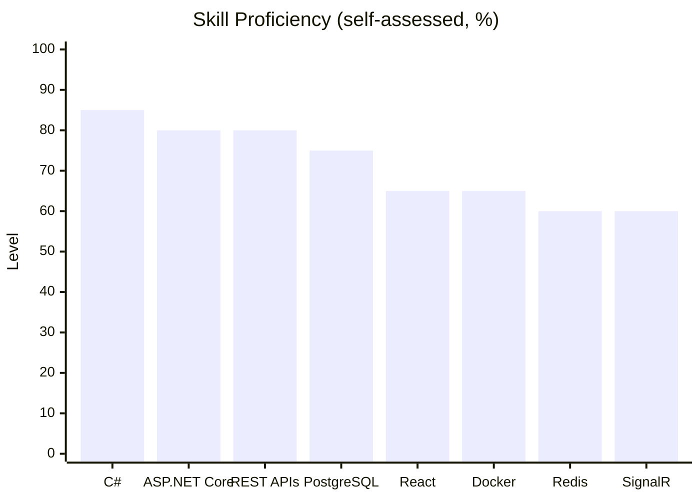

# Hey there 👋

### Hi, I'm Sai Sasank Vanapalli, a Backend .NET Developer 🚀 from India

I love building reliable backend applications, clean REST APIs, and efficient systems.

<!-- Resume badge: uncomment and replace YOUR_RESUME_LINK

-->

---

## 🔗 Connect with me

- 💼 **LinkedIn:** [linkedin.com/in/sai-sasank-vanapalli](https://www.linkedin.com/in/sai-sasank-vanapalli/)
- 🐙 **GitHub:** [github.com/Blazeee-007](https://github.com/Blazeee-007)
- 🧠 **LeetCode:** [leetcode.com/u/sidzzz_eren](https://leetcode.com/u/sidzzz_eren/)
- 📧 **Email:** [saisasankvanapalli@gmail.com](mailto:saisasankvanapalli@gmail.com)
<!-- - 📄 **Resume:** [View resume](YOUR_RESUME_LINK) -->

---

## 👨‍💻 About Me

- 🎓 Final-year B.Tech Computer Science Engineering student
- 💻 Backend-focused .NET Developer
- 🌱 Currently improving System Design, DSA, and database design
- 🧠 Solving DSA problems on LeetCode
- 🛠️ Love working on REST APIs, Databases, and Scalable Systems
- 💬 Ask me about C#, .NET, ASP.NET Core, APIs, SQL

---

## 🛠️ Tech Stack

### Languages

### Backend & APIs

### Frontend

### Databases & Caching

### Tools & Platforms

### 📈 Skill Proficiency

---

## 🧩 LeetCode Stats

  

---

## 🚀 What I'm Focusing On

- Writing clean, maintainable backend code
- Advanced C# and ASP.NET Core
- Authentication, authorization and database optimization
- Improving DSA & problem-solving
- Learning System Design and scalable applications

---

  <i>"Great software is built one line of code at a time."</i>

  ⭐ If you like my work, feel free to check out my repositories and connect with me!

